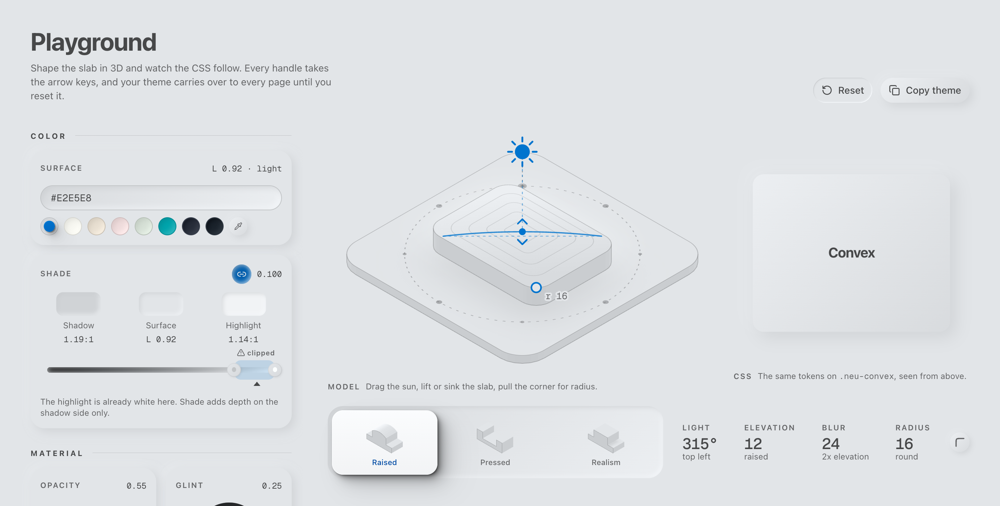
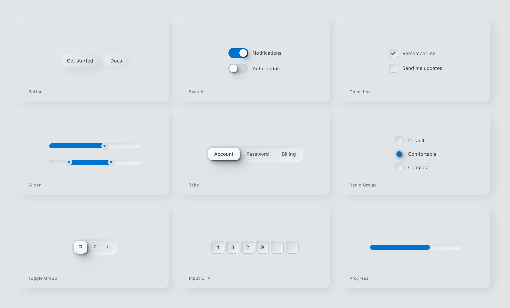

# neu

Neumorphic components for React and Tailwind v4, distributed as a shadcn
registry. The components keep the shadcn/ui APIs. One token, `--neu-surface`,
drives the shadows, faces, focus ring and text colors, and text contrast is
solved against the surface.

It is one material, soft extruded surfaces, not a general design system. You
copy the source into your app with the shadcn CLI; there is no npm package.

Docs, the components gallery and the playground:
[neu.beyondtheinnovation.com](https://neu.beyondtheinnovation.com).

<picture>
  <source media="(prefers-color-scheme: dark)" srcset="docs/assets/readme/hero-dark.png">
  
</picture>

## Who it is for

React developers who want a neumorphic interface for their own app and need it
to hold up where the style usually breaks: on a white parent, in dark mode, on
a brand color, with the keyboard and on right-to-left pages. neu installs
beside stock shadcn/ui, so you can use it for one screen or for the whole app.

<picture>
  <source media="(prefers-color-scheme: dark)" srcset="docs/assets/readme/components-dark.png">
  
</picture>

## Install

Add the theme, then any component. Each component pulls the theme in through
its registry dependencies.

```bash
bunx --bun shadcn@latest add https://neu.beyondtheinnovation.com/r/neu-theme.json
bunx --bun shadcn@latest add https://neu.beyondtheinnovation.com/r/neu-button.json
```

Components install under `components/ui/neu/`, next to the stock shadcn
components. Put `.neu-ground` on a page or section wrapper so they sit on their
own surface. The [installation guide](https://neu.beyondtheinnovation.com/installation)
covers the rest.

The theme needs Chrome 119, Safari 16.4 or Firefox 128 (relative color syntax
and trigonometric functions in `calc()`).

## Use

```tsx
import { Button } from "@/components/ui/neu/button";

export default function Page() {
  return (
    <main className="neu-ground min-h-screen p-8">
      <Button>Press me</Button>
    </main>
  );
}
```

A new theme is one token. Shadows, faces, the focus ring and text colors all
follow it:

```css
.dark {
  --neu-surface: oklch(0.25 0.02 250);
}
```

On right-to-left pages, `side="left"` on the sidebar and sheet means the
inline start, so a default sidebar sits on the right.

Keep Tailwind `shadow-*`, `ring-*` and `transition-*` utilities off neu
elements. Tailwind draws rings and shadows with `box-shadow`, which replaces
the neu shadow stack. Use `outline-*` for focus and invalid states.

## Accessibility

WCAG 2.2 conformance in the Accessibility Conformance Report format
([VPAT 2.5](https://www.itic.org/policy/accessibility/vpat)). It covers the
components, not an app built with them: criteria about page titles,
navigation, language and content belong to the app and read Not Applicable.

Measured on 2026-10-22 in Chrome 155 with Playwright and axe-core, in light
and dark, on every component page. `bun run scorecard:measure` re-runs the
contrast, focus and axe figures, and `tests/contrast.spec.ts` checks text
contrast on every CI run. The keyboard, pointer, zoom and reflow rows come from
one-off Playwright checks and a read of the source. No screen reader testing
yet.

| Level | Supports | Partially Supports | Does Not Support | Not Applicable |
| --- | --- | --- | --- | --- |
| A (31 criteria) | 16 | 5 | 0 | 10 |
| AA (24 criteria) | 11 | 5 | 0 | 8 |

Every partly supported criterion except 1.4.11 behaves the same in stock
shadcn/ui, since neu keeps its component behavior. The tables below give
the reason for each row.

<details>
<summary>Level A (31 criteria)</summary>

| Criteria | Conformance Level | Remarks and Explanations |
| --- | --- | --- |
| [1.1.1 Non-text Content](https://www.w3.org/WAI/WCAG22/Understanding/non-text-content) | Partially Supports | Icon-only controls have names. About 35 decorative icons lack aria-hidden, so screen readers can meet them as unnamed images. |
| [1.2.1 Audio-only and Video-only (Prerecorded)](https://www.w3.org/WAI/WCAG22/Understanding/audio-only-and-video-only-prerecorded) | Not Applicable | No neu component plays audio or video. |
| [1.2.2 Captions (Prerecorded)](https://www.w3.org/WAI/WCAG22/Understanding/captions-prerecorded) | Not Applicable | No neu component plays audio or video. |
| [1.2.3 Audio Description or Media Alternative (Prerecorded)](https://www.w3.org/WAI/WCAG22/Understanding/audio-description-or-media-alternative-prerecorded) | Not Applicable | No neu component plays audio or video. |
| [1.3.1 Info and Relationships](https://www.w3.org/WAI/WCAG22/Understanding/info-and-relationships) | Supports | Labels, dialog titles, tables, lists and form errors are tied together in code. CardTitle and AlertTitle render a div; nest a heading where the page needs one. |
| [1.3.2 Meaningful Sequence](https://www.w3.org/WAI/WCAG22/Understanding/meaningful-sequence) | Supports | DOM order matches visual order in left-to-right and right-to-left layouts, including open overlays. |
| [1.3.3 Sensory Characteristics](https://www.w3.org/WAI/WCAG22/Understanding/sensory-characteristics) | Supports | No component text gives instructions by shape, color, size, position or sound. |
| [1.4.1 Use of Color](https://www.w3.org/WAI/WCAG22/Understanding/use-of-color) | Supports | States use a glyph, position, elevation or text as well as color. An invalid field also thickens its border, and Form adds the message text. |
| [1.4.2 Audio Control](https://www.w3.org/WAI/WCAG22/Understanding/audio-control) | Not Applicable | No neu component plays audio. |
| [2.1.1 Keyboard](https://www.w3.org/WAI/WCAG22/Understanding/keyboard) | Partially Supports | Every control works from the keyboard except Context Menu. Its trigger cannot take focus, so the menu needs a pointer. |
| [2.1.2 No Keyboard Trap](https://www.w3.org/WAI/WCAG22/Understanding/no-keyboard-trap) | Supports | Focus can always leave. Modal overlays hold focus while open and release it on Escape or close. |
| [2.1.4 Character Key Shortcuts](https://www.w3.org/WAI/WCAG22/Understanding/character-key-shortcuts) | Supports | No single-key shortcuts. The sidebar uses Ctrl/Cmd+B and toasts use Alt+T. |
| [2.2.1 Timing Adjustable](https://www.w3.org/WAI/WCAG22/Understanding/timing-adjustable) | Partially Supports | Toasts close after 4 seconds, including ones with an Undo action. Hover and focus pause the timer, but there is no close button or way to extend it. |
| [2.2.2 Pause, Stop, Hide](https://www.w3.org/WAI/WCAG22/Understanding/pause-stop-hide) | Supports | Only loading indicators move on their own (Spinner, Skeleton). Carousel does not autoplay. |
| [2.3.1 Three Flashes or Below Threshold](https://www.w3.org/WAI/WCAG22/Understanding/three-flashes-or-below-threshold) | Supports | Nothing flashes. |
| [2.4.1 Bypass Blocks](https://www.w3.org/WAI/WCAG22/Understanding/bypass-blocks) | Not Applicable | Skip links and landmarks are page structure, which the app owns. |
| [2.4.2 Page Titled](https://www.w3.org/WAI/WCAG22/Understanding/page-titled) | Not Applicable | The app sets page titles. |
| [2.4.3 Focus Order](https://www.w3.org/WAI/WCAG22/Understanding/focus-order) | Partially Supports | Dialogs, sheets, popovers, menus and Select move focus in and back to the trigger. Drawer never takes focus, and the mobile sidebar drops focus to the page on close. |
| [2.4.4 Link Purpose (In Context)](https://www.w3.org/WAI/WCAG22/Understanding/link-purpose-in-context) | Supports | Link text comes from the app. Pagination previous, next and ellipsis carry names ("Go to previous page", "More pages"). |
| [2.5.1 Pointer Gestures](https://www.w3.org/WAI/WCAG22/Understanding/pointer-gestures) | Supports | Carousel and drawer swipes have button or tap alternatives. |
| [2.5.2 Pointer Cancellation](https://www.w3.org/WAI/WCAG22/Understanding/pointer-cancellation) | Supports | Controls act on release. Tabs, Select and menus open on press, which is reversible and commits nothing. |
| [2.5.3 Label in Name](https://www.w3.org/WAI/WCAG22/Understanding/label-in-name) | Supports | Accessible names contain the visible text. All 70 calendar day names start with the visible day number. |
| [2.5.4 Motion Actuation](https://www.w3.org/WAI/WCAG22/Understanding/motion-actuation) | Not Applicable | No component reads device motion. |
| [3.1.1 Language of Page](https://www.w3.org/WAI/WCAG22/Understanding/language-of-page) | Not Applicable | The app sets the page language. |
| [3.2.1 On Focus](https://www.w3.org/WAI/WCAG22/Understanding/on-focus) | Supports | Taking focus never navigates, submits or opens a dialog. |
| [3.2.2 On Input](https://www.w3.org/WAI/WCAG22/Understanding/on-input) | Supports | Changing a value never changes context. Tabs and radios update only their own panel. |
| [3.2.6 Consistent Help](https://www.w3.org/WAI/WCAG22/Understanding/consistent-help) | Not Applicable | Help placement across pages is the app's. |
| [3.3.1 Error Identification](https://www.w3.org/WAI/WCAG22/Understanding/error-identification) | Supports | Form marks the field invalid, shows the error as text, links it to the field and focuses the first invalid field. |
| [3.3.2 Labels or Instructions](https://www.w3.org/WAI/WCAG22/Understanding/labels-or-instructions) | Supports | Label, FormLabel and FormDescription carry labels and instructions; the app writes them. |
| [3.3.7 Redundant Entry](https://www.w3.org/WAI/WCAG22/Understanding/redundant-entry) | Not Applicable | Multi-step processes are the app's. |
| [4.1.2 Name, Role, Value](https://www.w3.org/WAI/WCAG22/Understanding/name-role-value) | Partially Supports | axe finds 0 violations across its 30 name, role and value rules on 51 pages. Progress does not pass its value on, so screen readers hear no percentage. |

</details>

<details>
<summary>Level AA (24 criteria)</summary>

| Criteria | Conformance Level | Remarks and Explanations |
| --- | --- | --- |
| [1.2.4 Captions (Live)](https://www.w3.org/WAI/WCAG22/Understanding/captions-live) | Not Applicable | No neu component plays audio or video. |
| [1.2.5 Audio Description (Prerecorded)](https://www.w3.org/WAI/WCAG22/Understanding/audio-description-prerecorded) | Not Applicable | No neu component plays audio or video. |
| [1.3.4 Orientation](https://www.w3.org/WAI/WCAG22/Understanding/orientation) | Supports | Nothing locks orientation. |
| [1.3.5 Identify Input Purpose](https://www.w3.org/WAI/WCAG22/Understanding/identify-input-purpose) | Supports | Input and Textarea pass autoComplete through. Input OTP defaults to one-time-code. |
| [1.4.3 Contrast (Minimum)](https://www.w3.org/WAI/WCAG22/Understanding/contrast-minimum) | Supports | Text color is solved in CSS from the surface: 7.24:1 in light and 7.23:1 in dark, and 4.84:1 at worst on a mid gray surface. axe flags only disabled labels, which are exempt. |
| [1.4.4 Resize Text](https://www.w3.org/WAI/WCAG22/Understanding/resize-text) | Partially Supports | No component text clips at 200%. Popover has no max height, so the combobox and date picker popovers run off screen and cannot scroll. |
| [1.4.5 Images of Text](https://www.w3.org/WAI/WCAG22/Understanding/images-of-text) | Supports | Components render text as text. |
| [1.4.10 Reflow](https://www.w3.org/WAI/WCAG22/Understanding/reflow) | Partially Supports | At 320 px wide, overlays, menus, Calendar and toasts fit; Table and Carousel scroll in place. Alert titles clip to one line, a context menu opened mid-screen runs off the edge, and four or more tabs overflow. |
| [1.4.11 Non-text Contrast](https://www.w3.org/WAI/WCAG22/Understanding/non-text-contrast) | Partially Supports | Focus rings reach 3.25:1 or more, and checked, on and selected states 3.02:1 or more. Field edges are a tonal line at 1.34 to 1.40:1, and in light the active tab and toggle-group item sit at 1.42 and 1.44:1. With prefers-contrast: more these become 7.05:1 and 5.92:1. |
| [1.4.12 Text Spacing](https://www.w3.org/WAI/WCAG22/Understanding/text-spacing) | Supports | With the WCAG text spacing applied, no component text clips or overlaps. |
| [1.4.13 Content on Hover or Focus](https://www.w3.org/WAI/WCAG22/Understanding/content-on-hover-or-focus) | Supports | Tooltip and Hover Card stay open while hovered, close on Escape, and also open on focus. |
| [2.4.5 Multiple Ways](https://www.w3.org/WAI/WCAG22/Understanding/multiple-ways) | Not Applicable | Site navigation is the app's. |
| [2.4.6 Headings and Labels](https://www.w3.org/WAI/WCAG22/Understanding/headings-and-labels) | Not Applicable | Heading and label text comes from the app. |
| [2.4.7 Focus Visible](https://www.w3.org/WAI/WCAG22/Understanding/focus-visible) | Supports | Focus is an outline, never a shadow. All 115 focus stops in the gallery show it at 3.25:1 or more, as do menu items, OTP slots and toast buttons. |
| [2.4.11 Focus Not Obscured (Minimum)](https://www.w3.org/WAI/WCAG22/Understanding/focus-not-obscured-minimum) | Partially Supports | Nothing covers the focused element except stacked toasts, where Tab can land on an older toast behind the newest one. |
| [2.5.7 Dragging Movements](https://www.w3.org/WAI/WCAG22/Understanding/dragging-movements) | Partially Supports | Slider, drawer and carousel drags have click or tap alternatives. The resizable handle can only be dragged; arrow keys move it, but they do not count here. |
| [2.5.8 Target Size (Minimum)](https://www.w3.org/WAI/WCAG22/Understanding/target-size-minimum) | Supports | 560 targets on 51 pages are 24 by 24 px or larger, or meet the spacing or equivalent exception (inline links, resizable handles, sidebar rail). |
| [3.1.2 Language of Parts](https://www.w3.org/WAI/WCAG22/Understanding/language-of-parts) | Not Applicable | The app marks language changes in its content. |
| [3.2.3 Consistent Navigation](https://www.w3.org/WAI/WCAG22/Understanding/consistent-navigation) | Not Applicable | Navigation across pages is the app's. |
| [3.2.4 Consistent Identification](https://www.w3.org/WAI/WCAG22/Understanding/consistent-identification) | Not Applicable | Components keep the same names and icons wherever they appear; labels across pages are the app's. |
| [3.3.3 Error Suggestion](https://www.w3.org/WAI/WCAG22/Understanding/error-suggestion) | Supports | FormMessage shows the schema's message, so the app's validation text reaches the user. |
| [3.3.4 Error Prevention (Legal, Financial, Data)](https://www.w3.org/WAI/WCAG22/Understanding/error-prevention-legal-financial-data) | Not Applicable | Confirmation steps are the app's. Alert dialog is available for them. |
| [3.3.8 Accessible Authentication (Minimum)](https://www.w3.org/WAI/WCAG22/Understanding/accessible-authentication-minimum) | Supports | Input OTP accepts paste, so a code can be copied instead of transcribed. Sign-in flows are the app's. |
| [4.1.3 Status Messages](https://www.w3.org/WAI/WCAG22/Understanding/status-messages) | Supports | Toasts announce through a polite live region, Spinner is a status and Alert an alert. Form errors are read when their field takes focus. |

</details>

<details>
<summary>Level AAA (2 criteria measured, the rest not evaluated)</summary>

| Criteria | Conformance Level | Remarks and Explanations |
| --- | --- | --- |
| [1.4.6 Contrast (Enhanced)](https://www.w3.org/WAI/WCAG22/Understanding/contrast-enhanced) | Supports | Text reaches 7.24:1 on the default light surface and 7.23:1 on dark. A custom mid gray surface caps any text color at 4.84:1. |
| [2.3.3 Animation from Interactions](https://www.w3.org/WAI/WCAG22/Understanding/animation-from-interactions) | Supports | prefers-reduced-motion stops slide, sink and expand motion in all 13 components that move. Opacity fades stay, which the criterion does not count as motion. |

</details>

## Known gaps

- No chart component.
- Ten WCAG 2.2 A and AA criteria are partially supported (see Accessibility).
- Squircle corners need Chrome 139; other browsers draw round corners.
- This is 0.1.0 with one maintainer. Component APIs follow shadcn/ui, but the
  theme tokens may still change before 1.0.

## Develop

```bash
bun install
bun run dev
```

`registry.json` lists the registry items and `registry/neu/` holds their
source. `bun run registry:build` regenerates the served JSON in `public/r/`.
Structure, conventions and checks are in [AGENTS.md](AGENTS.md).

## Contributing and security

Issues and pull requests are welcome. Commits need a DCO sign-off; see
[CONTRIBUTING.md](CONTRIBUTING.md). Report security issues privately as
described in [SECURITY.md](SECURITY.md). neu is maintained by
[Beyond The Innovation](https://beyondtheinnovation.com).

## Credits

The light model's trig comes from [junwen-k/tailwindcss-neumorphism-ui](https://github.com/junwen-k/tailwindcss-neumorphism-ui) (MIT).

## License

MIT. See [LICENSE](LICENSE).
